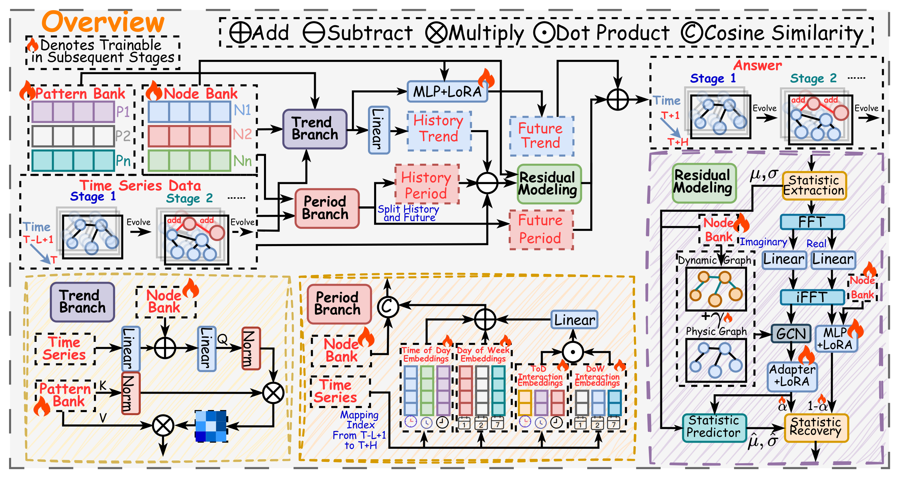
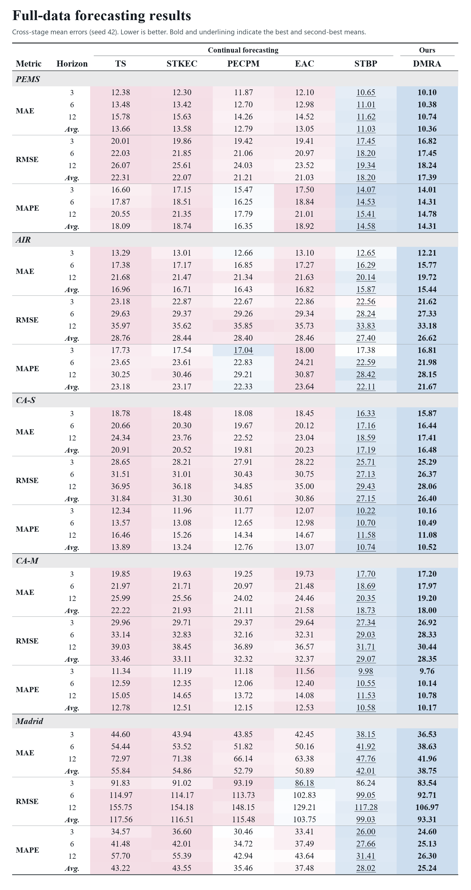

# DMRA

**Dual Memories and Residual Adaptation for Continual Spatio-Temporal Forecasting**

DMRA forecasts existing and newly deployed sensors as a network evolves. Given a recent observation window, each node retrieves a local trend from a shared pattern bank. A periodic bank models how the node’s daily profile changes across days of the week. DMRA then forecasts the remaining residual using the node’s own history and its spatial neighbors, and estimates its future mean and scale. After the first stage, the model updates the node embeddings and both memories and learns a new low-rank update for each prediction branch.

[Model](#model) · [Datasets](#datasets) · [Quick start](#quick-start) · [Results](#full-data-results) · [Ablations](#ablations)

## Model



[Vector version of the architecture](figures/framework.pdf)

## Datasets

The release includes the stage observations, physical graphs, and Madrid’s observation masks and month-selection metadata. Each stage uses its first 60% for training, the next 20% for validation, and the final 20% for testing. All experiments below use a 12-step history to predict the next 12 steps.

| Dataset | Observations | Stage dates | Nodes per stage | Sampling |
| --- | --- | --- | --- | --- |
| PEMS | Traffic | 2011, 2012, 2013, 2014, 2015, 2016, 2017 | 655, 715, 786, 822, 834, 850, 871 | 5 min |
| AIR | Air quality | 2016, 2017, 2018, 2019 | 1,087, 1,154, 1,193, 1,202 | 1 h |
| CA-S | California traffic, single year | Feb, Apr, Oct, Dec 2020 | 128, 256, 512, 1,024 | 5 min |
| CA-M | California traffic, multiple years | Jan 2017, Apr 2018, Dec 2019, Apr 2020, Jul 2021 | 128, 256, 512, 1,024, 2,048 | 5 min |
| Madrid | Madrid traffic | Feb 2022, Aug 2023, Apr 2024, Aug 2025, Jun 2026 | 256, 320, 384, 448, 499 | 15 min |

PEMS and AIR follow the released continual forecasting benchmarks. The two California streams are derived from LargeST. The Madrid stream uses traffic intensity and measurement-point coordinates published by Ayuntamiento de Madrid under CC BY 4.0. The dataset archive retains the original Madrid attribution and processing manifest. [EAC benchmarks](https://github.com/Onedean/EAC) · [LargeST](https://github.com/liuxu77/LargeST) · [Madrid traffic data](https://datos.madrid.es/dataset/208627-0-transporte-ptomedida-historico) · [Madrid measurement points](https://datos.madrid.es/dataset/202468-0-intensidad-trafico)

## Quick start

Clone the repository and extract the dataset at its root. The training logs are a separate download and are optional for training.

```bash
git clone https://github.com/Cosinecos/DMRA.git
cd DMRA
curl -fL --retry 3 -O https://github.com/Cosinecos/DMRA/releases/download/v1.0.0/dmra-data.zip
unzip -q dmra-data.zip
```

Use Python 3.11 and install PyTorch for your hardware. The following example uses PyTorch 2.2.1 with CUDA 12.1 on Linux.

```bash
python -m pip install torch==2.2.1 --index-url https://download.pytorch.org/whl/cu121
python -m pip install -r requirements.txt
bash run_dmra.sh all 0 42 --check-data
```

Train DMRA on one dataset or run all five sequentially. The last two positional arguments select the GPU and random seed.

```bash
bash run_dmra.sh PEMS 0 42
# Or train on all five datasets
bash run_dmra.sh all 0 42
```

The public model class is `dmra.DMRA`. The launcher defaults to source-scale inputs, masked MAE, up to 200 epochs per stage, and early stopping after 30 epochs without improvement in validation MAE. The next stage inherits the preceding stage’s validation-best weights. Stage-specific low-rank updates are added to the trend MLP, the node-wise residual MLP, and both projections of the graph adapter.

### Continual baselines

Prepare the six upstream predictors at their pinned revisions and run the full-data comparisons. Each model uses its own continual update rule. The suite runs TS, STKEC, PECPM, EAC, and STBP on all five datasets and STRAP on PEMS, AIR, CA-S, and CA-M. [Baseline sources and training settings](continual/README.md)

```bash
python continual/install_upstream.py all
bash run_baseline.sh all all 0 42
```

## Full-data results

Mean test errors for DMRA and the continual baselines with released full-data training records (seed 42). Each dataset has equal-weight stages. Horizons 3, 6, and 12 cover all steps up to that horizon. Within each stage, Avg. averages the twelve prefix scores. Lower values indicate smaller errors.

[](figures/full_data_results.png)

[Download the values behind the figure](results/full.csv) · [Training logs](https://github.com/Cosinecos/DMRA/releases/download/v1.0.0/dmra-training-logs.zip)

```bash
curl -fL --retry 3 -O https://github.com/Cosinecos/DMRA/releases/download/v1.0.0/dmra-training-logs.zip
sha256sum -c results/SHA256SUMS
unzip -q dmra-training-logs.zip
```

The archive includes the training log, configuration, stage results, and summary for each run. In the archived paths, `runs_integrated_shared_kv` identifies DMRA. The index distinguishes the paper’s raw-input experiments from the additional full-data baseline runs with input normalization. [Run index](results/run_index.csv)

## Ablations

| Variant | Change to DMRA |
| --- | --- |
| `no_node_bank` | Remove node identity conditioning and the dynamic graph derived from node embeddings. |
| `no_pattern_bank` | Remove pattern retrieval and both the historical and future trend components. |
| `no_season` | Remove the periodic branch, including its calendar embeddings and day–week interaction. |
| `no_lora` | Keep the first-stage base predictors and adapter and continue updating the shared parameters. Omit all stage-specific LoRA updates. |
| `no_dynamic_graph` | Use the physical graph for propagation and retain node embeddings in the other branches. |
| `reuse_history_stats` | Use the historical residual mean and scale to restore the forecast directly. |

```bash
bash run_ablation.sh all all raw 0 42
```

[Full-data ablation results](results/ablations.csv)

## Acknowledgments

We thank the authors of the continual forecasting baselines and the providers of the traffic and air-quality observations. The experimental interfaces build on the released benchmark implementations. [STBP](https://github.com/Aoyu-Liu/STBP) · [Upstream implementation credits](continual/README.md)

