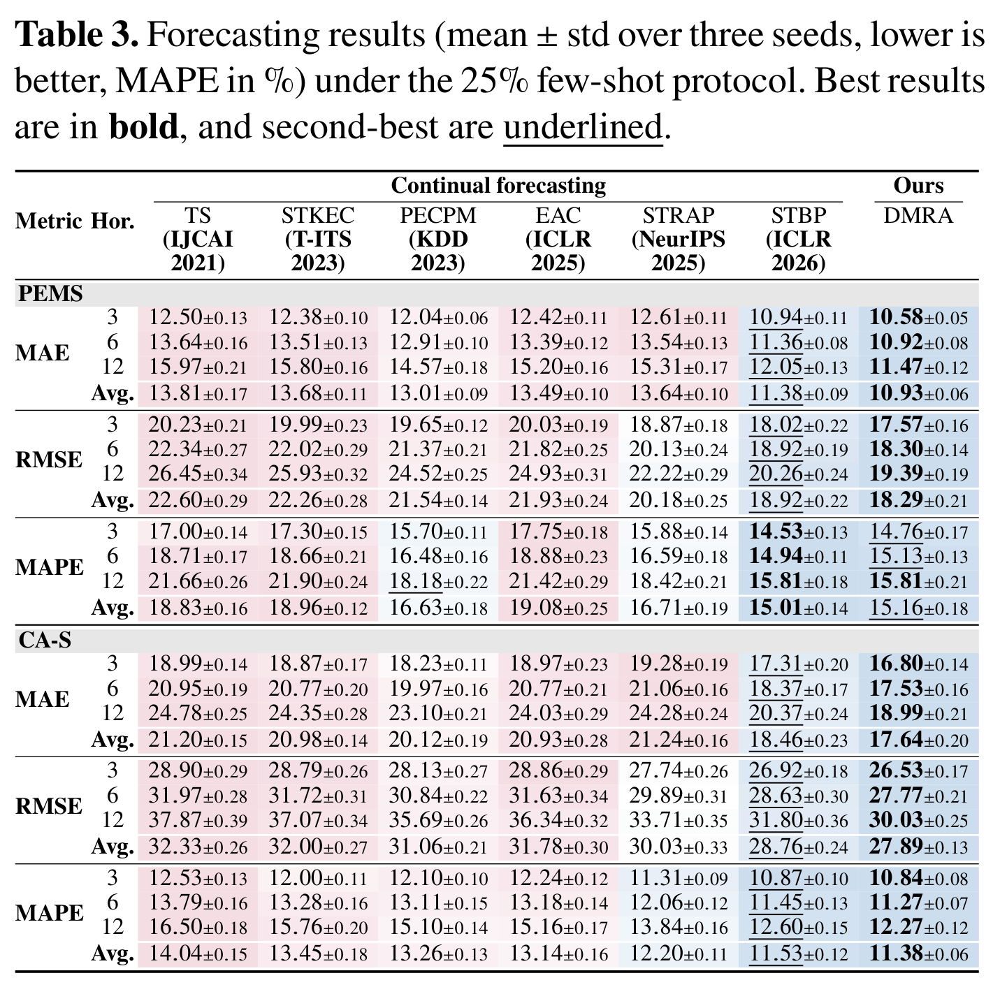

# DMRA

Dual Memories and Residual Adaptation for Continual Spatio-Temporal Forecasting.

## Model


[Vector version of the architecture](figures/framework.pdf)

## Setup

Use Python 3.11 in a virtual environment and run the commands from the repository root in Bash (Git Bash on Windows). This example installs PyTorch for CUDA 12.1.

```bash
python -m pip install torch==2.2.1 --index-url https://download.pytorch.org/whl/cu121
python -m pip install -r requirements.txt --index-url https://pypi.org/simple
python continual/install_upstream.py all
```

For CPU-only use, replace `cu121` with `cpu` in the PyTorch command and pass `-1` as the device. The upstream installer fetches the six continual baselines from their [pinned sources](continual/upstream.lock.json) under their respective terms. The launchers reassemble the data included in the repository on first use.

## Train

Run from the repository root with Bash. The examples run the main experiments with GPU 0 and seed 42.

```bash
bash run_dmra.sh all 0 42
bash run_baseline.sh all all 0 42
bash run_forecast.sh all all 0 42
```

Choose one dataset with `PEMS`, `AIR`, `CA-S`, `CA-M`, or `Madrid`. The continual baselines are TS, STKEC, PECPM, EAC, STBP, and STRAP. STRAP supports the first four datasets. The forecasting baselines are TQNet, GWNet, STID, and PatchTST.

To check the data and run a short training check on CPU:

```bash
bash run_dmra.sh all -1 42 --check-data
bash run_dmra.sh CA-S -1 42 --smoke --epochs 1
bash run_baseline.sh all CA-S -1 42 --smoke --epochs 1
bash run_forecast.sh all CA-S -1 42 --smoke --epochs 1
```

Historical main-experiment logs are in [`logs/`](logs/). The repository contains no pretrained weights. Training selects the best validation checkpoint at each stage for use in the next stage.

PEMS and AIR follow the [EAC benchmarks](https://github.com/Onedean/EAC). The California streams are derived from [LargeST](https://github.com/liuxu77/LargeST).

Madrid data are adapted from Ayuntamiento de Madrid traffic intensity and measurement-point coordinates under CC BY 4.0. [Traffic data](https://datos.madrid.es/dataset/208627-0-transporte-ptomedida-historico) · [Measurement points](https://datos.madrid.es/dataset/202468-0-intensidad-trafico) · [License](https://creativecommons.org/licenses/by/4.0/)

## Full-data results

Horizons 3, 6, and 12 cover all steps up to that horizon. Within each stage, Avg. averages the twelve prefix scores. Lower values indicate smaller errors.

[](figures/full_data_results.png)

## Few-shot results

Under the 25% few-shot protocol, only the earliest 25% of each stage is used for training.

[](figures/fewshot_results.png)

## Acknowledgments

We thank the authors of [TrafficStream (TS)](https://github.com/AprLie/TrafficStream), [STKEC](https://github.com/UnderReview24/STKEC), [PECPM](https://github.com/UnderReview24/PECPM), [EAC](https://github.com/Onedean/EAC), [STRAP](https://github.com/HoweyZ/STRAP), and [STBP](https://github.com/Aoyu-Liu/STBP) for sharing the implementations used in our continual forecasting experiments. We also thank the providers of the traffic and air-quality data.
